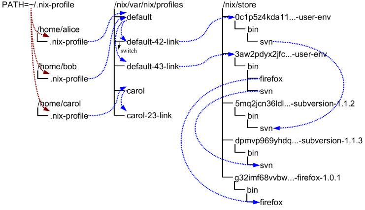

# Profile

Profile 和用户环境是 Nix 实现「不同用户拥有不同配置」以及「原子升级与回滚」能力的机制。要理解它们的工作原理，最好先对 Nix 的工作方式有一点了解。在 Nix 中，软件包存储在 *Nix store*（通常是 `/nix/store`）中各自独一无二的路径里。例如，某个特定版本的 Subversion 软件包可能存储在目录 `/nix/store/dpmvp969yhdqs7lm2r1a3gng7pyq6vy4-subversion-1.1.3/` 中，而另一个版本可能存储在 `/nix/store/5mq2jcn36ldlmh93yj1n8s9c95pj7c5s-subversion-1.1.2`。目录名前缀的长字符串是加密哈希值（准确地说，是 SHA-256 哈希的 160 位截断，以 [Nix32](@docroot@/protocols/nix32.md) 编码），它由*构建*该软件包所涉及的*全部*输入决定 —— 源码、依赖、编译器标志等等。因此，只要两个软件包存在任何差异，它们就会位于文件系统中的不同位置，彼此互不干扰。下面是一个典型 Nix store 的一部分的样子：



当然，你不会想每次运行 Subversion 时都输入

```console
$ /nix/store/dpmvp969yhdq...-subversion-1.1.3/bin/svn
```

这样的命令。我们固然可以把要使用的每个软件包的 `bin` 目录都加入 `PATH` 环境变量，但这并不方便，因为修改 `PATH` 对已经存在的进程不会生效。Nix 采用的解决方案是为*已激活*的软件包创建由符号链接组成的目录树。这些目录树被称为*用户环境*（user environment），它们本身也是软件包（不过是由 `nix-env` 自动生成的），因此同样存放在 Nix store 中。例如，在上图中，用户环境 `/nix/store/0c1p5z4kda11...-user-env` 只包含一个指向 Subversion 1.1.2 的符号链接（图中的箭头表示符号链接）。这相当于我们在一组包含 Subversion 1.1.2 的 Nix 表达式上执行了

```console
$ nix-env --install --attr nixpkgs.subversion
```

之后得到的结果。

当然，这本身并没有解决问题；你同样不想输入 `/nix/store/0c1p5z4kda11...-user-env/bin/svn`。这就是为什么在 store 之外还存在指向 store 内用户环境的符号链接；例如示例中的 `default-42-link` 和 `default-43-link`。它们被称为 *generation*，因为每次执行 `nix-env` 操作时，都会基于当前用户环境生成一个新的用户环境。例如，generation 43 是在我们执行

```console
$ nix-env --install --attr nixpkgs.subversion nixpkgs.firefox
```

（针对一组包含 Firefox 和新版本 Subversion 的 Nix 表达式）时由 generation 42 创建的。

Generation 被归组到 *profile* 中，这样不同用户之间就可以在互不干扰的情况下各用各的配置。例如：

```console
$ ls -l /nix/var/nix/profiles/
...
lrwxrwxrwx  1 eelco ... default-42-link -> /nix/store/0c1p5z4kda11...-user-env
lrwxrwxrwx  1 eelco ... default-43-link -> /nix/store/3aw2pdyx2jfc...-user-env
lrwxrwxrwx  1 eelco ... default -> default-43-link
```

这里显示了一个名为 `default` 的 profile。文件 `default` 本身实际上是一个指向当前 generation 的符号链接。当我们执行 `nix-env` 操作时，会基于当前用户环境创建一个新的用户环境和 generation 链接，最后让 `default` 符号链接指向新的 generation。最后这一步在 Unix 上是原子操作，这解释了原子升级是如何实现的。（注意，新软件包的构建/安装不会以任何方式干扰旧软件包，因为它们存储在 Nix store 的不同位置。）

如果你发现想要撤销某次 `nix-env` 操作，只需执行

```console
$ nix-env --rollback
```

它会让当前的 generation 链接指向上一个链接。例如，`default` 会指向 `default-42-link`。你也可以切换到某个特定的 generation：

```console
$ nix-env --switch-generation 43
```

在本例中，这将再次前滚到 generation 43。你还可以查看所有可用的 generation：

```console
$ nix-env --list-generations
```

一般来说，你不会把 `/nix/var/nix/profiles/some-profile/bin` 放进自己的 `PATH`。实际上存在一个符号链接 `~/.nix-profile`，它指向你当前的 profile。这意味着你应该把 `~/.nix-profile/bin` 放入 `PATH`（事实上，初始化脚本 `/nix/etc/profile.d/nix.sh` 正是这样做的）。这样做使得切换到不同的 profile 更加容易。你可以使用命令 `nix-env --switch-profile` 来完成切换：

```console
$ nix-env --switch-profile /nix/var/nix/profiles/my-profile

$ nix-env --switch-profile /nix/var/nix/profiles/default
```

这两条命令分别切换到 `my-profile` 和默认 profile。如果该 profile 不存在，它会被自动创建。将 profile 存放在 `profiles` 目录之外的位置时应当小心，否则它可能不会被用作[垃圾回收器](garbage-collection.md)的根。

所有 `nix-env` 操作都作用于 `~/.nix-profile` 指向的 profile，但你可以使用 `--profile` 选项（缩写 `-p`）覆盖这一行为：

```console
$ nix-env --profile /nix/var/nix/profiles/other-profile --install --attr nixpkgs.subversion
```

这*不会*改变 `~/.nix-profile` 符号链接。
